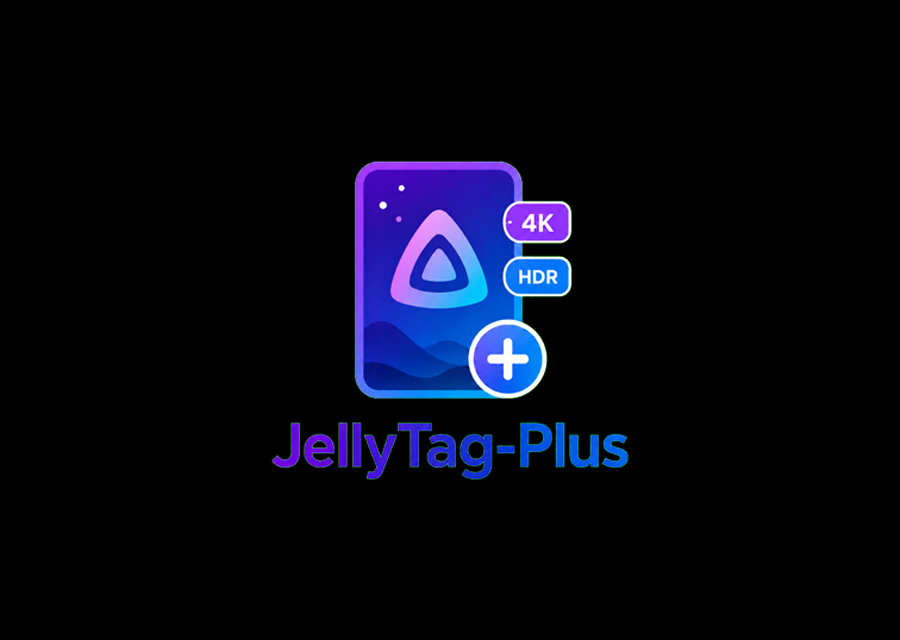
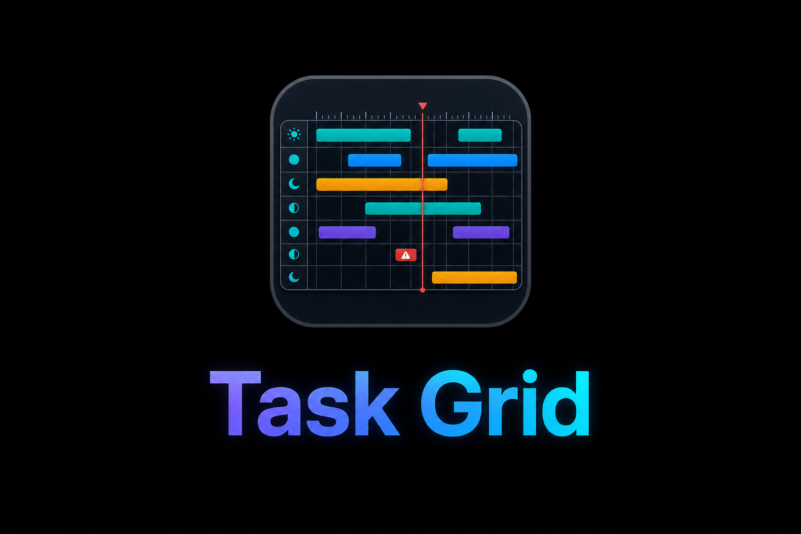

# nothing2obvi Jellyfin Plugins

  

This repository is a fork of [Atilil/jellyfin-plugins](https://github.com/Atilil/jellyfin-plugins).

The main active change in this fork is **JellyTag-Plus**, a renamed and expanded fork of the original plugin. **WatchSync has not been touched yet**, so if you only want WatchSync, it is best to use the original repository from Atilil.

> **Disclaimer:** The original plugins in [Atilil/jellyfin-plugins](https://github.com/Atilil/jellyfin-plugins) are described by their author as built from vibecoding; see [Atilil/jellyfin-plugins#17](https://github.com/Atilil/jellyfin-plugins/issues/17). The additional and modified features in JellyTag-Plus in this fork are also vibecoded.

## Installation

1. Open Jellyfin and go to **Administration -> Dashboard -> Plugins -> Repositories**
2. Click **Add** and enter:
   - **Name:** `nothing2obvi Plugins`
   - **URL:** `https://raw.githubusercontent.com/nothing2obvi/jellyfin-plugins/main/manifest.json`
3. Click **Save**
4. Go to **Catalog** and install the plugin you want
5. Restart Jellyfin

## Available Plugins

### WatchSync

    

WatchSync automatically synchronizes watch history between libraries of different qualities, such as 4K and HD libraries.

**Fork status:** WatchSync is currently unchanged from the original plugin in [Atilil/jellyfin-plugins](https://github.com/Atilil/jellyfin-plugins). For WatchSync, use the original repository unless you specifically want everything from this fork in one plugin repository.

[More details](WatchSync/README.md)

---

### JellyTag-Plus

    

JellyTag-Plus adds quality, language, and collection badges to Jellyfin posters and thumbnails.

- Resolution, HDR, codec, audio, language, VOST, and collection badges
- Regex-based collection rules with custom images
- Per-library and per-image-target badge controls
- Alphabetized language flags with an undetermined-language fallback
- Optional Force Image Refresh for stubborn client caches
- Cache warmer with fixed client profiles and learned sizes for dynamic layouts

[More details](Jellytag/README.md)

---

### Task Grid

    

Task Grid shows Jellyfin scheduled tasks on a Monday-first weekly grid, with days as rows and hours as columns. It includes per-task colors, heavy-task overlap warnings, a refresh button for recent schedule changes, and red warnings for tasks whose most recent result was aborted by server shutdown.

**Fork status:** Task Grid is not a fork of [Atilil/jellyfin-plugins](https://github.com/Atilil/jellyfin-plugins). It is a new plugin added in this repository.

[More details](TaskGrid/README.md)

---

## Requirements

- Jellyfin 10.11.0 or higher
- .NET 9 SDK, if building from source

## License

MIT License - see [LICENSE](LICENSE) file.

## Author

**nothing2obvi**

## Disclaimer

This project includes code derived from the original Jellyfin plugin repository and local modifications for JellyTag-Plus.
