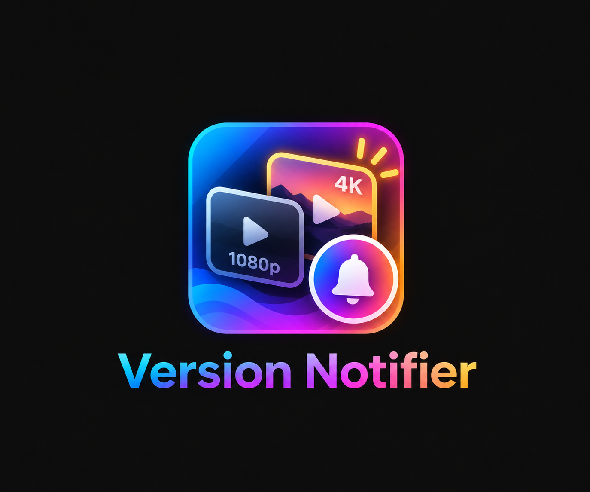

# Version Notifier

Watching the HD copy when a 4K copy is available? Version Notifier quietly lets that playback session know. It supports movies and TV episodes, never switches playback, and never modifies your library or media files.

## Compatibility and installation

Built for **Jellyfin 12.x**, targeting the **12.0.0 SDK / .NET 10**. Older Jellyfin releases are not supported by this DLL.

1. Open **Dashboard → Plugins → Repositories**, and add:
   - **Name:** `nothing2obvi Plugins`
   - **URL:** `https://raw.githubusercontent.com/nothing2obvi/jellyfin-plugins/main/manifest.json`
2. Open **Catalog**, select **Version Notifier**, and install version **1.0.0.0**.
3. Restart Jellyfin, then open **Dashboard → Plugins → Version Notifier**.

Already using this repository? Refresh the catalog and look for Version Notifier.

For manual installation, download [the release ZIP](https://github.com/nothing2obvi/jellyfin-plugins/releases/download/jellyfin-plugins/version-notifier-1.0.0.0-jellyfin12.zip), stop Jellyfin, and extract it into `VersionNotifier_1.0.0.0` inside your plugins directory (usually `/config/plugins` in Docker). Start Jellyfin again. Install the complete package to include its dashboard artwork.

To build from source, run `./build.sh` from this folder with the .NET 10 SDK and Python 3 installed. It runs tests and creates `output/version-notifier-1.0.0.0-jellyfin12.zip`.

## Settings

- **Enable notifications:** on by default.
- **Notification delay:** 15 seconds by default; accepts 0–300 seconds.
- **Notification message:** `[Auto] This title is also available in 4K.`

Blank messages fall back to the default. Settings use Jellyfin's normal plugin configuration storage. The delay is captured when playback starts; the message and enabled setting are checked again before delivery.

## How matching works

Grouped versions use Jellyfin's media-source information. Separate movie libraries use matching TMDb, IMDb, or TVDB IDs; conflicting shared IDs reject a match. Separate episode libraries also require matching series IDs, display order, season, episode, and multi-episode range. Episode-level ID conflicts reject a match too. No filename or title-name guessing: similar names and remakes are not enough.

The plugin checks the **source actually selected for playback**, so a 4K file being transcoded to 1080p does not trigger an alert. Video width of at least 3800 pixels or height of at least 2160 pixels counts as 4K, including typical cropped ultrawide UHD releases. It checks each alternative's visibility for the current user, including library and parental restrictions.

Matching runs after the delay, using filtered provider-ID queries and, for episodes, matching series/season/episode queries. There is no full-library scan or long-lived result cache. Media and permissions are read fresh for each check.

## Notification behavior and limitations

- Only the initiating playback session receives the message, with an eight-second display timeout requested from the client.
- Repeated starts, seeks, pauses, and resumes do not repeat the notification for an active playback. Stops, title changes, session endings, and shutdown cancel pending work. Starting a genuinely new playback can notify again.
- Switching sources cancels the pending alert; the plugin verifies the current item, user, and source immediately before sending.
- Clients must advertise Jellyfin's `DisplayMessage` command. Actual display style and timeout depend on the client; delivery failures are caught and logged at debug level without interrupting playback.
- Missing resolution data, unresolvable media-source IDs, or missing reliable metadata cause the plugin to skip the alert. Separate copies with different episode numbering/display orders are deliberately not guessed.
- This uses scanned media information, without probing or opening files. An offline mount or file removed since the last library scan may still be advertised by Jellyfin; refresh the library to clear stale entries.

## Verification

Automated tests exercise grouped and separate-library movies/episodes, selected-source resolution, cropped UHD, identity conflicts, episode ranges, access restrictions, configuration defaults and customization, duplicate events, cancellation, session changes, unsupported clients, and send failures. The test harness uses Jellyfin 12 types with substituted library/session services.

A real-server check is still needed for dashboard rendering, Jellyfin's actual grouping and permission filtering, and message delivery on your particular clients. Suggested smoke test: play HD and 4K copies in both library layouts, try a restricted user, then stop/switch playback during the delay.

The notification implementation follows Transcode Guard's plain `ISessionManager.SendMessageCommand` pattern. Artwork is the supplied original, losslessly recompressed with unnecessary metadata removed and color information retained.
