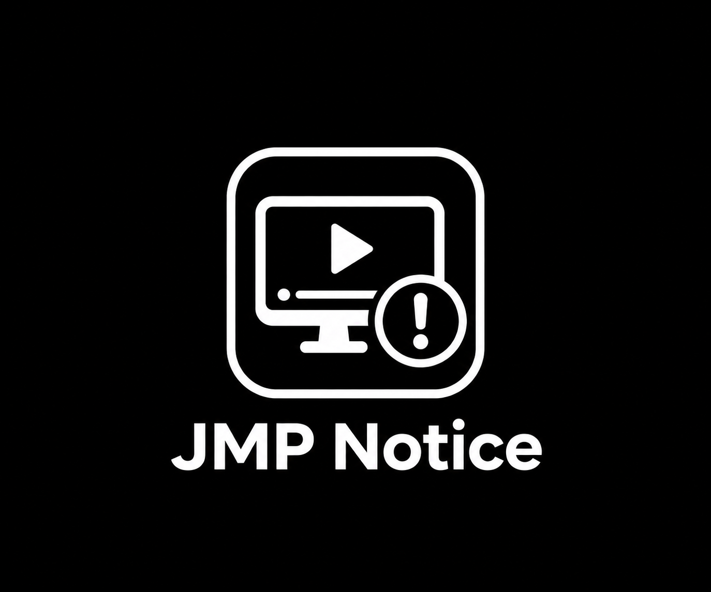

# JMP Notice

JMP Notice sends a native Jellyfin message to users of **Jellyfin Media Player**, suggesting they read your Discord announcement for alternatives. It never changes playback, inserts videos, or modifies media.

> **Note:** This plugin was created for my personal Jellyfin server and reflects my preference for users to migrate away from the archived Jellyfin Media Player. It is not a plugin I necessarily recommend for other Jellyfin administrators. It exists to address a specific preference on my own server, rather than a universal need.

## Compatibility and installation

Built against **Jellyfin 12.0.0 / .NET 10**, following the sibling Version Notifier plugin. Intended for Jellyfin 12.x; older server versions are unsupported. Compatibility with a running server has not yet been checked.

1. With .NET 10 SDK and Python 3 installed, run `./build.sh` in this directory.
2. Stop Jellyfin and extract `output/jmp-notice-0.1.0.0-jellyfin12.zip` into `JmpNotice_0.1.0.0` under the server's plugins directory (usually `/config/plugins` in Docker).
3. Restart Jellyfin. Open **Dashboard → Plugins → JMP Notice** to configure it.

Source: [nothing2obvi/jellyfin-plugins](https://github.com/nothing2obvi/jellyfin-plugins/tree/main/jellyfin-plugin-jmp-notice). Download the **0.1** release from [GitHub Releases](https://github.com/nothing2obvi/jellyfin-plugins/releases/tag/jmp-notice-0.1).

For catalog installation, add `https://raw.githubusercontent.com/nothing2obvi/jellyfin-plugins/main/manifest.json` in **Dashboard → Plugins → Repositories**, install **JMP Notice 0.1.0.0**, then restart Jellyfin.

## Configuration

- **Enable notifications:** on by default.
- **Notification message:** `Jellyfin Media Player has been archived. Please see the Discord announcement for better alternatives.`
- **Display duration:** 12 seconds by default, configurable from 1–60 seconds.

The title is always **JMP Notice**. Blank messages use the default; out-of-range durations are clamped. The plugin does not create or link a Discord announcement; administrators should provide that separately.

## Detection and delivery

Notifications appear when Jellyfin Media Player connects and **whenever a distinct playback starts**. Multiple items played within the same session produce repeated notices, including automatic episode/track transitions. Detection has no media-type filter: movies, episodes, music, Live TV, and other playable items use the same native playback-start event.

Connection and playback notices are tracked separately. Repeated events for the same playback item and play-session ID do not repeat a notice. A new play-session ID permits replaying the same item; a matching playback-stop event resets the fallback marker for clients that omit play-session IDs. Progress reports, buffering, seeks, pauses, and resumes do not trigger notices.

A pending connection notice merges with one playback start. If the connection notice was just sent, the first playback start within two seconds consumes that overlap instead of displaying an identical notice simultaneously. Subsequent playback starts still notify, even within that window. Distinct playback starts are never merged with each other.

Only the complete reported application name `Jellyfin Media Player` matches (case insensitive). All application versions match. Jellyfin Desktop, Jellium Desktop, Pelagica, Plezy, Jellyfin Web, and names with extra suffixes do not match. Detection trusts the client's reported name.

The hosted service listens to Jellyfin's session-start, controller-connected, capabilities-changed, playback-start, playback-stop, and session-end events. It also observes sessions already present when the service starts. There is no periodic session scan and no playback-progress handler.

Each notice waits 250 milliseconds to allow client initialization, then checks for an active messaging controller. If unavailable, it checks twice more at two-second intervals. A pending notice can resume its readiness checks on a later eligible event. It sends only `ISessionManager.SendMessageCommand` to the matching session, with the configured text and timeout. No play, pause, stop, seek, or source-selection command is issued. The dashboard configuration page is a standard embedded plugin page; no script is injected into Jellyfin clients.

New sessions, new active controller identities, and observed disconnected-to-connected transitions generate connection notices. Repeated events with the same active controllers do not. Session-end events remove tracking and cancel pending work. Tracking is in memory; restarting the server/plugin resets it.

## Delivery limitations and verification

A successful server send is not a client display acknowledgement. Each trigger is attempted at most once after reaching the send step, even if sending throws, because retrying an ambiguous transport failure could duplicate a visible notice. A failed send does not suppress later distinct playback or connection triggers. A disconnected or unready client cannot receive a notice; pending readiness checks resume on a later eligible event. Disabling takes effect at the next readiness check; enabling takes effect on the next eligible event.

**Server-side detection limits:** playback coverage depends on JMP reporting native playback-start events. A client that omits those events for a stream or automatic transition cannot be detected reliably by this plugin. If a client omits/reuses play-session IDs, an uninterrupted replay of the same item without a stop event is indistinguishable from a duplicate start and may be suppressed. Conversely, if a client reports a resume/seek as a start with a fresh play-session ID, it may generate a notice. Normal progress/resume events do not.

A reconnect that creates a new server session or controller is detected. If the server reuses the same session/controller and does not expose an inactive state between connection events, a genuine reconnect is indistinguishable from a repeated connection event and may not notify. The public session event contains the session, not a unique socket-connection identifier; the plugin does not inspect private socket state or guess reconnects using a timer. See Jellyfin's [session events](https://github.com/jellyfin/jellyfin/blob/master/Emby.Server.Implementations/Session/SessionManager.cs) and [websocket controller](https://github.com/jellyfin/jellyfin/blob/master/Emby.Server.Implementations/Session/WebSocketController.cs). No claim of complete launch/reconnect or playback coverage is made without live testing.

Source inspection of Jellyfin Web's [native message handler](https://github.com/jellyfin/jellyfin-web/blob/master/src/scripts/serverNotifications.js) supports delivery outside playback: `DisplayMessage` invokes the notification handler without requiring an active video. The [server session model](https://github.com/jellyfin/jellyfin/blob/master/MediaBrowser.Controller/Session/SessionInfo.cs) exposes messaging controllers independently of playback. This is architectural evidence, not confirmation on an installed JMP client. JMP builds, embedded Web versions, websocket/reverse-proxy configuration, focus behavior, and client initialization can affect display. The requested timeout and title may be rendered differently or ignored by clients.

Automated tests use Jellyfin 12 types and substituted session services. They cover exact client matching across versions, connection readiness and deduplication, observable reconnections, separate playback starts across media types, automatic transitions, same-item replays with new play-session IDs, launch/playback overlap, progress/pause/resume exclusion, configuration, cancellation, and send failures. They check that notification handling issues no playback commands. They cannot prove actual visual delivery or uninterrupted playback on a real client.

Before deployment, verify on your server:

1. Launch JMP and browse without playback; confirm one notice. Relaunch and reconnect to test how your server exposes connection changes.
2. Start a movie, then a TV episode in the same session; confirm a fresh notice for each start. Check automatic next-episode playback.
3. Play music and let the next track advance automatically; test Live TV and any other media types you use.
4. Start playback immediately after launch; confirm one combined notice, then a fresh notice for the next item.
5. Seek, buffer, pause, and resume; confirm no additional notice and uninterrupted playback. Stop and replay the same item; confirm a fresh notice.
6. Check the exact message, requested 12-second display, dashboard saving, disabled mode, and custom text.
7. Repeat with Jellyfin Web and alternative desktop clients and confirm no notice.

No live Jellyfin/JMP session was available during development. Movie, television, and automatic-transition coverage is verified only through simulated native server events. Actual visual delivery and playback behavior remain unverified on a real client.
